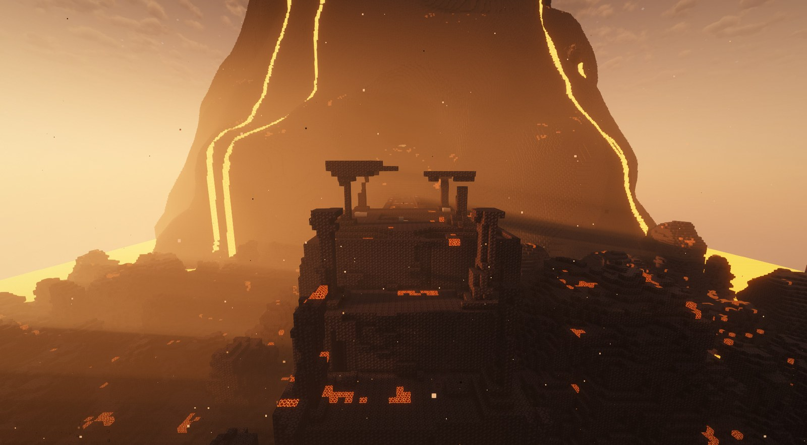
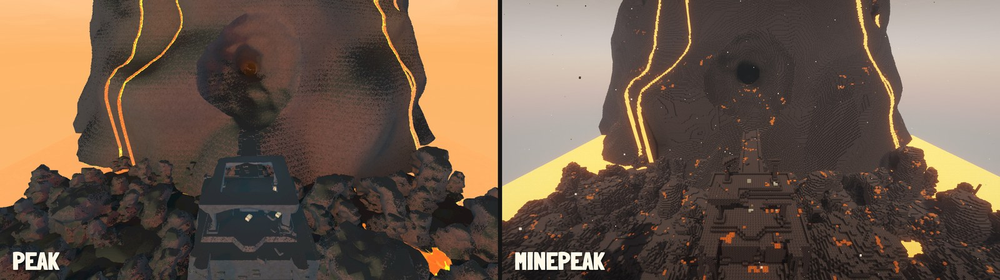
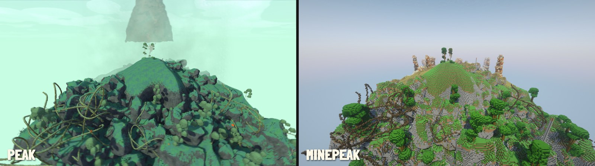
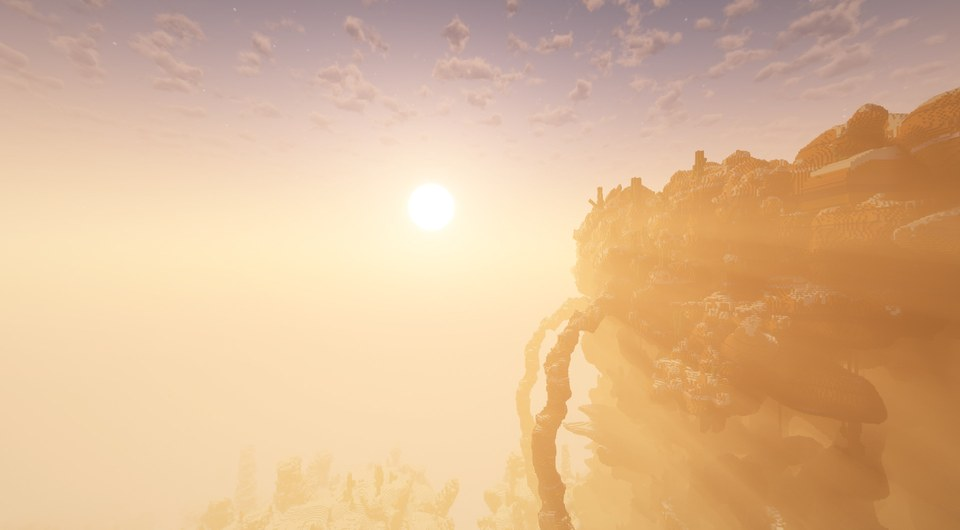
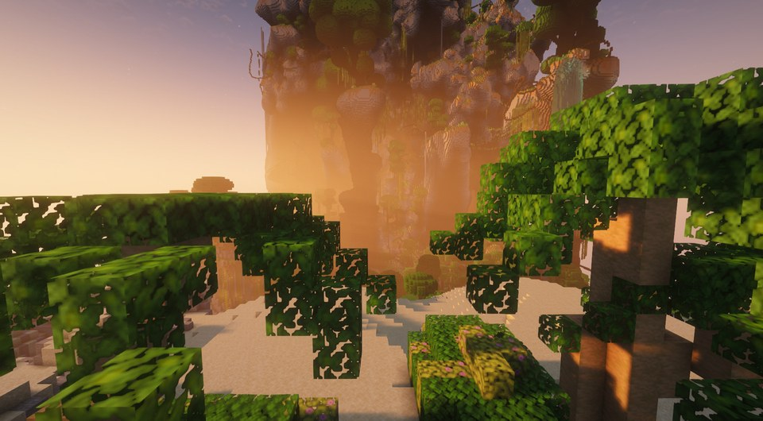
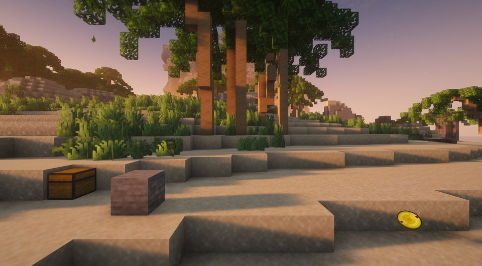
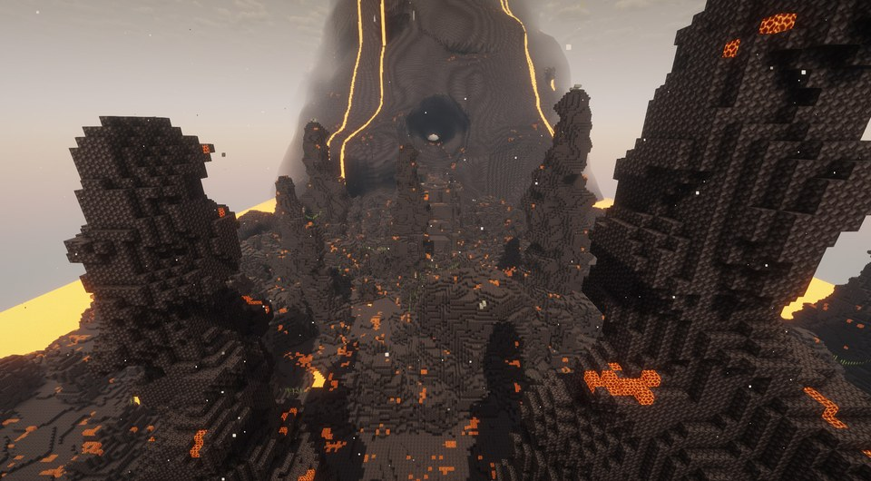

# MinePeak

PEAK inside Minecraft. Climb PEAK's real island of the day, exported from your own copy of PEAK, with PEAK's
rules: its stamina and climbing, its statuses, its items, its fog, its campfires and its ending.

## What it does

- **Today's island.** PEAK's daily island (the Shore, the Tropics or the Roots, the Alpine or the Mesa, the Caldera, the
  Kiln and the peak) built block by block, about 1,400 blocks tall, from an export your own PEAK makes on your PC.
- **PEAK's body.** PEAK's stamina bar is your health: injury, hunger, cold, heat, poison, spores, drowsiness, curse and
  weight fill it from the right. Climb any wall (hold left click, as in PEAK); hang from pitons; pass out when the bar fills, and have a friend carry
  you, feed you, or bring you back at a scout statue.
- **PEAK's items.** All of PEAK's real items, with their icons (made from your PEAK), doing what they do in PEAK: food
  and medicine, ropes, pitons, the rescue claw, balloons, the parasol and glider, lanterns, flares, bugles, the
  checkpoint flag, the scout effigy, the scout cannon, backpacks...
- **Three pockets.** PEAK's hotbar and backpack slot in place of Minecraft's inventory.
- **The island's life.** Suitcases with PEAK's loot, berries and coconuts where PEAK grows them, mushroom zombies,
  scorpions, beetles, PEAK's bee swarms (take their hive and run), mandrakes hiding among the medicinal roots, antlions
  in their sliding sand pits, capybaras, vines and rope bridges, geysers, rusty pitons, flash plants, the Caldera's
  eruptions, the Kiln's rising lava, PEAK's fog and the wind.
- **PEAK's ending.** A flare at the top calls the rescue; PEAK's end screen and badges (as advancements).
- **PEAK's sounds and look.** Its music, ambience and sound effects, its fonts, menus and HUD, its screen effects (a
  knock's red, the cold's frost, poison, heat, drowsiness...) and camera shake, all from your PEAK.

## Pictures

The same spots in PEAK (left) and in MinePeak (right):

| | |
|---|---|
|  |  |
|  |  |

*MinePeak's pictures were taken with Iris and the Complementary Unbound shaders, which aren't part of MinePeak.*

## Requirements

- Minecraft 26.2 with Fabric Loader and Fabric API.
- PEAK (Steam), with the **MinePeak Exporter** BepInEx plugin installed in a copy of PEAK. MinePeak starts that copy
  in the background (no window, no sound) once a day to export the island.
- Steam running while it exports.

## Install

1. Put `minepeak-<version>.jar` and Fabric API in your Minecraft `mods` folder.
2. Unzip `MinePeakExporter-<version>.zip` anywhere and double-click **Install MinePeak Exporter.cmd**. It copies your
   Steam PEAK to `%LOCALAPPDATA%\MinePeak\PEAK` (about 2 GB; your Steam PEAK is only read, never changed, and mods in it
   aren't copied), installs BepInEx 5 in the copy (it asks before downloading BepInExPack_PEAK from Thunderstore), and
   puts the exporter in it. MinePeak finds the copy by itself.
3. On the title screen, **PLAY OFFLINE → Create New World** makes a MinePeak world of today's island (the first
   time a day, after a few minutes' export).

Run the installer again after PEAK updates. (By hand instead: copy PEAK somewhere, install BepInEx 5 in the copy, put
`MinePeakExporter.dll` in its `BepInEx/plugins/MinePeakExporter`, and set `peakExe` in `config/minepeak.json` to the
copy's `PEAK.exe`.)

Everything MinePeak takes from PEAK (the island, the pictures, the sounds, the item data) is made on your PC from your
own PEAK, into `%APPDATA%/MinePeak`. Nothing of PEAK's ships with MinePeak.

## Troubleshooting

- The title screen says what's wrong in red (PEAK not found, Steam not running...). The export's logs are in the
  PEAK copy: `Player-export.log` and `BepInEx/MinePeakData/export.log`.
- Minecraft's own log: `logs/latest.log` (MinePeak's lines start with "MinePeak").
- Found a bug, or something that isn't how PEAK does it? [Open an issue](https://github.com/E1GAT0-dotcom/MinePeak/issues)
  (with those logs, if you can).

## Multiplayer

Play it on a server with the mod, or open your world to friends: in a MinePeak world, the pause menu's
**INVITE FRIENDS** opens Minecraft's own pause menu, with Open to LAN and the buttons of mods that let friends join a
single-player world (Essential, World Host; e4mc works through Open to LAN). Everyone needs MinePeak and Fabric API. The
island comes from the host's world; each player's own PEAK export gives them PEAK's pictures and sounds (without one,
they see Minecraft's in their place). Carrying, feeding a friend, statues, campfires (every scout must be there), the
Scoutmaster and badges work for every scout.

## Support

MinePeak is free. If you enjoy it, you can support its maker on [Ko-fi](https://ko-fi.com/chairsoftware).

## Credits

- PEAK by Aggro Crab and Landfall. MinePeak is an unofficial fan project, not affiliated with them.
- Fonts: Darumadrop One and Londrina Solid, under the SIL Open Font License (their licences are in the mod's `licenses` folder).
- Fabric, Fabric API, BepInEx, Harmony, Newtonsoft.Json.
- Built with Claude Code (Anthropic's Claude), with the author directing and testing.

## Licence

MinePeak's code: MIT.

## Building

- **The mod** (JDK 25): `cd mod`, then `gradlew build -Prelease`. The jar is in `mod/build/libs`.
- **The exporter** (.NET SDK): it builds against a copy of PEAK with BepInEx 5 installed, for PEAK's and BepInEx's DLLs:
  `cd exporter`, then `dotnet build -c Release -p:PeakDir=<that copy's folder>`. The build also puts the plugin into that
  copy's `BepInEx/plugins/MinePeakExporter`.
- **The exporter's installer zip**: `tools/package_exporter.ps1` (after building the exporter), into `dist/`.
